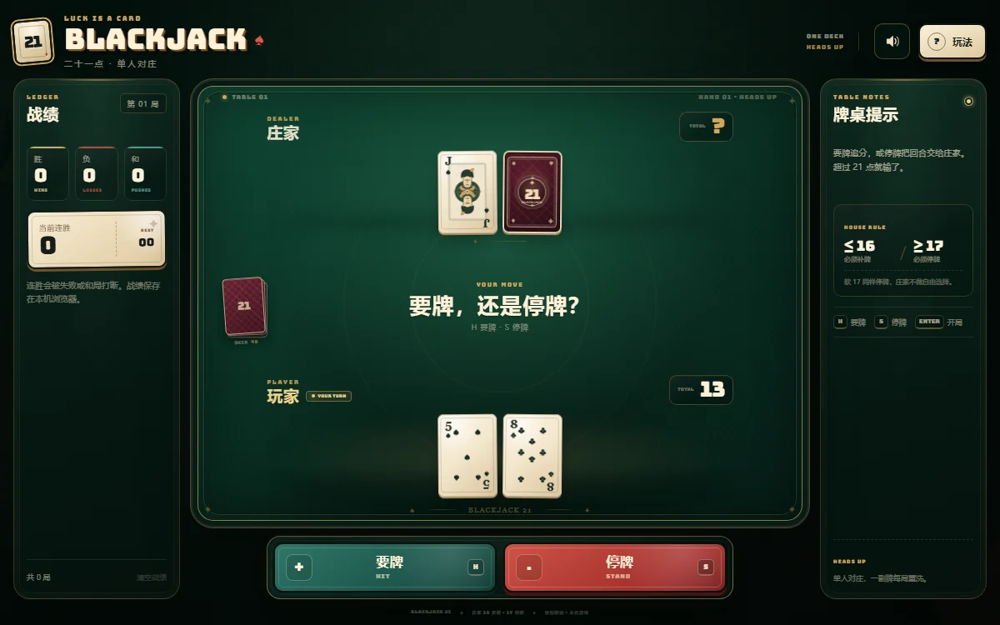
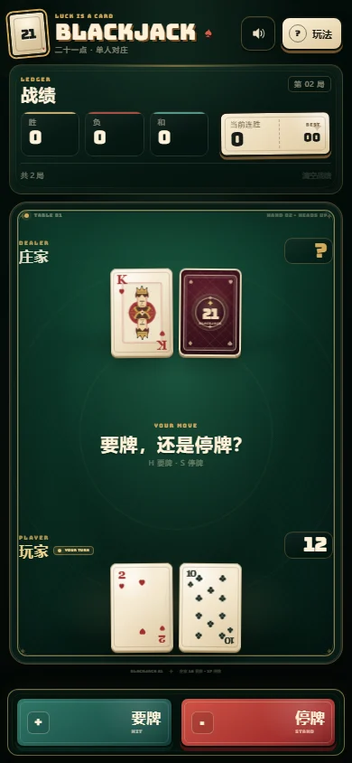

# BLACKJACK 21

一款单人对庄的 21 点网页游戏，采用经典扑克牌面与复古拼贴风格。你只需要在「要牌」和「停牌」之间做决定。

<p align="center">
  
</p>

<details>
  <summary>手机端预览</summary>
  <p align="center">
    
  </p>
</details>

## 特性

- 单人对庄，完整实现发牌、暗牌、要牌、停牌与结算流程。
- A 自动取最优值；庄家 16 点及以下要牌，17 点及以上停牌（包括软 17）。
- 支持天牌、爆牌、平局、普通比大小，以及跨局战绩和连胜统计；局数与战绩都会持久化，清空战绩需二次确认并同步归零。
- 经典牌面排布、自绘 J/Q/K 人头牌、酒红牌背和暗绿毡面牌桌。
- 发牌、翻牌、印章、屏幕震动等动效，支持 `prefers-reduced-motion`。
- Web Audio API 实时合成音效，无外部音频素材。
- 桌面端要牌 / 停牌收在牌桌右下角，手牌保持居中，停牌使用醒目红色；窄屏使用底部操作条。
- 适配桌面、平板和手机，整页按视口自适应、默认不出现滚动条，支持键盘操作与 `localStorage` 战绩保存。

## 快速开始

### 环境要求

- Node.js 22+
- pnpm 11+

### 本地运行

```bash
git clone https://github.com/A-jm-001/BlackJack-by-deepseek.git
cd BlackJack-by-deepseek
pnpm install
pnpm dev
```

开发服务器默认运行在 `http://127.0.0.1:5173/`。直接运行 `pnpm dev` 时请手动打开该地址；`start.cmd` 会在服务器就绪后自动打开浏览器。如果端口被占用，请以终端输出的 Local URL 为准。

Windows 下也可以直接双击 `start.cmd`，脚本会启动服务器并自动打开浏览器。

> **不要直接双击 `index.html`。** 它是 Vite 的 HTML 入口模板，必须由开发服务器加载；直接打开只会看到启动指引。

### 生产构建

```bash
pnpm build
pnpm preview
```

构建产物位于 `dist/`，可部署到任意静态网站托管服务。

## 游戏规则

- 单人对庄，使用一副标准 52 张牌，每局重新洗牌。
- 每局玩家与庄家各发两张牌，庄家的第二张为暗牌。
- A 可以算 1 点或 11 点，自动取最有利且不超过 21 点的值。
- 2–10 按面值计算，J、Q、K 都算 10 点。
- 玩家只能选择**要牌**或**停牌**。
- 庄家 **16 点及以下必须要牌，17 点及以上停牌**，软 17 也停牌。
- 开局两张牌凑成 21 点为 Blackjack；双方天牌为平局。
- 玩家爆牌立即结束，庄家不再补牌；双方都未爆牌则比较点数。
- 当前版本不包含下注、加倍、分牌和保险。

### 快捷键

| 按键 | 操作 |
| --- | --- |
| `H` | 要牌 |
| `S` | 停牌 |
| `Enter` | 开局 / 下一局 |
| `?` | 打开玩法说明 |

## 技术栈

| 层 | 实现 |
| --- | --- |
| 构建 | Vite 8 + React 19 + TypeScript strict |
| 样式 | 原生 CSS 自定义属性与响应式布局 |
| 画面 | CSS 与内联 SVG 原创绘制，无第三方图片素材 |
| 状态 | `useReducer` 状态机 + 纯函数规则引擎 |
| 音效 | Web Audio API 实时合成 |
| 字体 | 自托管 Bungee（SIL Open Font License），中文使用系统字体栈 |
| 测试 | Vitest |
| 包管理 | pnpm |

游戏是纯前端静态应用，没有后端接口；洗牌、规则判定和战绩都发生在浏览器本地。

## 项目结构

```text
.
├─ src/
│  ├─ game/          # 牌堆、点数、庄家策略、结算、状态机与测试
│  ├─ state/         # 游戏 hook、计时和本地存储
│  ├─ hooks/         # Web Audio 合成音效
│  ├─ components/    # 牌桌、手牌、牌面、操作键与规则弹窗
│  ├─ ui/            # 文案与花色标签
│  └─ styles/        # 设计变量、布局和卡牌样式
├─ public/           # favicon 等静态资源
├─ docs/             # README 预览图
├─ src/main.tsx
├─ index.html
├─ start.cmd         # Windows 一键启动
├─ vite.config.ts
└─ package.json
```

## 开发与检查

```bash
pnpm typecheck
pnpm test
pnpm build
```

规则逻辑与 UI 解耦，核心规则集中在 `src/game/`，通过 Vitest 覆盖：

- A 的 1/11 点取值与软牌计算
- 庄家 16/17 策略（含软 17）
- 天牌、爆牌、平局和普通比大小
- 状态机防重复结算
- 连胜与战绩统计

## 本地数据

- `blackjack.stats.v1`：胜、负、和、当前连胜、最佳连胜。
- `blackjack.settings.v1`：声音开关。
- 项目不使用账号系统，不上传游戏数据；刷新页面不会恢复进行中的牌局。

## 后续计划

- 筹码与下注循环
- 加倍、分牌和保险
- 多副牌牌靴与更丰富的牌桌规则
- 更完整的音效、动画和可访问性支持

## 致谢

整体视觉氛围受到桌面卡牌游戏与复古拼贴风格启发，但所有牌面、人头牌 SVG、牌背、图标、纹理和文案均为本项目原创，不含《小丑牌》（Balatro）的游戏素材，也与该作品及其发行商无关联。
